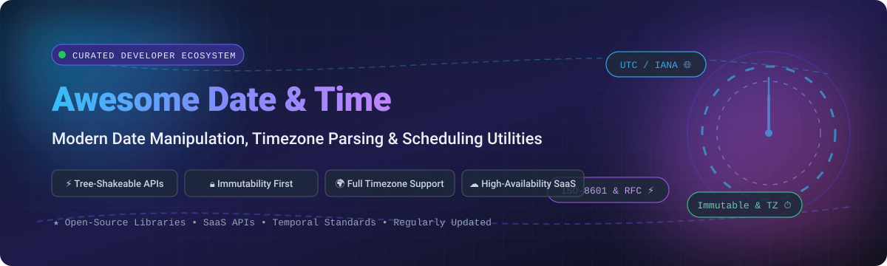

# ⏱️ Awesome Date &amp; Time Utilities 🌐

### *Curated developer catalog of high-performance Date, Time, Timezone &amp; Scheduling libraries and SaaS platforms*

  
  
  
  
  
  

  <b>Focused on Immutable APIs, Tree-Shakeable Functions, ISO-8601 Compliance &amp; Timezone-Aware Parsing</b> 
  <i>Essential toolkits for frontend developers, backend engineers, distributed cloud architectures, and date-handling systems.</i>

---

## 📑 Table of Contents

- [📊 Sector Overview &amp; Market Dynamics](#-sector-overview--market-dynamics)
- [☁️ SaaS / Hosted Platforms](#️-saas--hosted-platforms)
- [💻 Open-Source GitHub Projects](#-open-source-github-projects)
  - [Top Projects (Ranked by GitHub Stars)](#top-projects-ranked-by-github-stars)
  - [Next-Generation &amp; Specialized Utilities](#next-generation--specialized-utilities)
- [💡 Architectural Best Practices](#-architectural-best-practices)
- [🤝 How to Contribute](#-how-to-contribute)
- [💖 Support &amp; Sponsorship](#-support--sponsorship)
- [⚠️ Disclaimer](#️-disclaimer)
- [⭐ Star History](#-star-history)

---

## 📊 Sector Overview &amp; Market Dynamics

The global market for time synchronization, temporal APIs, and timezone SaaS infrastructure forms an estimated **$1.8B – $2.5B** subsector within developer tooling and cloud mapping APIs. The market structure is **moderately fragmented across SaaS lookup providers**, with hyperscalers (e.g., Google Maps Platform) dominating mission-critical enterprise geocoding and location-time translation, while an active long-tail of agile micro-SaaS and niche REST APIs address specialized timezone conversions and atomic clock time distribution. 

In contrast, the open-source client and server-side manipulation ecosystem exhibits **winner-take-most dynamics around 3-4 standardized modern libraries** (`Day.js`, `date-fns`, and `Luxon`), transitioning away from legacy monolithic utilities (`Moment.js`) toward lightweight, immutable primitives and the upcoming ECMAScript `Temporal` language specification standard.

---

## ☁️ SaaS / Hosted Platforms

A curated overview of managed APIs for coordinate-to-timezone resolution, international daylight saving calculations, and atomic time services.

| Platform | Company Valuation / Revenue | Starting Pricing Tier | Free Tier Limit | Description |
| :--- | :--- | :--- | :--- | :--- |
| **[Google Maps Time Zone API](https://developers.google.com/maps/documentation/timezone)** | **Alphabet Inc.: ~$2.32T+ Valuation** ($350B+ Annual Revenue) | **$5.00 / 1,000 requests** (pay-as-you-go after free tier) | **10,000 requests per month** (free forever with active billing account) | Enterprise-grade global time zone lookup service resolving UTC offset and daylight savings based on latitude/longitude coordinates. |
| **[Abstract API (Time & Timezone)](https://www.abstractapi.com/api/timezone-api)** | **Abstract: ~$50M+ Valuation** (Series A venture-backed) | **$12.00 / month** (billed annually) or **$19.00 / month** (billed monthly) | **5,000 requests total / month** (capped strictly at 1 request/sec, non-commercial only) | REST API for time, date, and timezone calculations, daylight saving adjustments, and location-based time lookups. |
| **[Time and Date API](https://www.timeanddate.com/services/api/)** | **Time and Date AS: ~$4.2M Annual Revenue** | **$49.00 / year** (Basic Package) | **3-month free trial** with access to all APIs (no credit card required; no permanent free tier) | Comprehensive global time, holiday, daylight saving, astronomy, and calendar data service. |
| **[World Time API](https://timeapi.world)** | **Independent / Micro-SaaS: <$1M Revenue** | **$5.00 / month** (Starter plan up to 50,000 requests/month) | **20,000 requests per month** (full API access, personal and commercial use allowed) | High-availability cloud REST API providing atomic time and timezone lookups across worldwide locations. |
| **[TimeZoneDB](https://timezonedb.com/)** | **Independent / Indie Micro-SaaS: <$1M Revenue** | **$5.00 / month** (or $50.00 / year) | **Unlimited requests** with a strict rate ceiling of **1 request per second** (personal & non-commercial use only) | Fast, lightweight REST API and downloadable timezone database querying time by coordinates, country, or zone. |
| **[TimeAPI.io](https://timeapi.io)** | **Independent / Open Developer Tool: <$1M Revenue** | **$0.00 / month** (community-supported; paid enterprise SLA plans in development) | **Free forever with high-volume fair usage** (no mandatory billing or API keys required) | Community-driven time conversion, timezone calculation, and date formatting REST API. |

---

## 💻 Open-Source GitHub Projects

### Top Projects (Ranked by GitHub Stars)

The most popular open-source libraries, utility tools, and parsers across the JavaScript, TypeScript, and broader open-source ecosystem, sorted in descending order of community GitHub stars:

1. **[Day.js](https://github.com/iamkun/dayjs)**  ⚡  
   **2KB immutable date library with a Moment.js-compatible API** (MIT) — The drop-in Moment replacement. If you know Moment.js, you already know Day.js. Features a fluent, chainable API (`dayjs().startOf('month').add(1, 'day').format('YYYY-MM-DD')`), immutability, on-demand locale loading (`import 'dayjs/locale/es'`), and modular plugin architecture (timezone, relativeTime, duration).

2. **[Moment.js](https://github.com/moment/moment)**  🏛️  
   **Parse, validate, manipulate, and display dates in JavaScript** (MIT) — The historical ecosystem standard and OpenJS Foundation project. Now in maintenance mode (no new architectural features accepted). Retains immense value for maintaining established applications, but new initiatives should migrate to Day.js, date-fns, or Luxon.

3. **[date-fns](https://github.com/date-fns/date-fns)**  🌲  
   **Modern JavaScript date utility library** (MIT) — The reference implementation for functional, immutable date manipulation. v4 introduces first-class timezone handling via `@date-fns/tz` (`TZDate` and `tz()` context helper). All functions are pure, return new `Date` objects, and support fine-grained tree-shaking via named imports (`import { addDays, formatISO } from 'date-fns'`).

4. **[Luxon](https://github.com/moment/luxon)**  🌐  
   **Modern date and time library from the Moment team** (MIT) — Provides first-class `DateTime`, `Duration`, and `Interval` types. Leverages the browser's native `Intl` API for timezone and locale handling, eliminating the need to bundle bulky timezone database files. Features clean, immutable, chainable methods (`DateTime.now().setZone("America/New_York").minus({ weeks: 1 }).toISO()`).

5. **[Chrono](https://github.com/wanasit/chrono)**  🗣️  
   **Natural language date parser in JavaScript / TypeScript** (MIT) — Extracts structured dates from informal human text (e.g., *"Tomorrow at 5pm"*, *"Next Friday"*, *"August 17 - August 19"*, *"2 weeks ago"*). Provides customizable ref dates, timezones, and multilingual parsing across English, Japanese, French, Dutch, German, and Portuguese.

6. **[Sugar.js](https://github.com/andrewplummer/Sugar)**  🍬  
   **JavaScript utility suite for native objects** (MIT) — Extends JavaScript's built-in objects with intuitive helper methods. Features a dedicated modular Date package (`sugar-date`) with fluent formatting, relative date calculations, date ranges, and custom build options.

7. **[Spacetime](https://github.com/spencermountain/spacetime)**  🌍  
   **Lightweight, timezone-centric date library** (MIT) — Built specifically for robust timezone calculations without Moment's weight. Accurately handles daylight saving shifts, non-IANA abbreviations, daylight boundaries, and includes an experimental wrapper for the upcoming TC39 Temporal proposal.

8. **[relative-time-element](https://github.com/github/relative-time-element)**  ⏱️  
   **GitHub's Web Component for human-readable relative dates** (MIT) — Custom element (`<relative-time>`) that formats timestamps as local relative strings (e.g., *"3 minutes ago"*, *"in 2 hours"*), auto-updating live in the DOM using standard browser localization.

9. **[moment-timezone](https://github.com/moment/moment-timezone)**  🗺️  
   **IANA timezone database support for Moment.js** (MIT) — The official companion library bringing full IANA timezone parsing, time calculation, and timezone conversion to Moment.js applications.

10. **[TC39 Proposal Temporal](https://github.com/tc39/proposal-temporal)**  🚀  
    **The upcoming ECMAScript Temporal specification** (Stage 3 / Candidate standard) — Modern, full-featured replacement for the legacy `Date` object directly built into JavaScript. Provides distinct types for timezone-aware dates (`Temporal.ZonedDateTime`), plain calendar dates (`Temporal.PlainDate`), durations, and nanosecond precision.

11. **[Noda Time](https://github.com/nodatime/nodatime)**  🛡️  
    **Alternative date and time API for .NET** (Apache-2.0) — Jon Skeet's port of Joda-Time to C#/.NET. Enforces explicit, type-safe separation between instants, calendar dates, local times, and zoned times, mitigating common software timezone bugs.

12. **[python-dateutil](https://github.com/dateutil/dateutil)**  🐍  
    **Powerful extensions to the standard Python datetime module** (Apache-2.0 / Dual) — Provides generic datetime parsing from almost any string format, fractional-second recurrence rules (rrule), and comprehensive timezone info (tz).

13. **[Tempo](https://github.com/formkit/tempo)**  🎵  
    **Elegant, lightweight date library by FormKit** (MIT) — Modern TypeScript-first toolkit focusing on formatting, parsing, and basic manipulation with zero dependencies. Combines the simplicity of Day.js with the functional tree-shakeability of date-fns.

14. **[fecha](https://github.com/taylorhakes/fecha)**  🪶  
    **Ultralight date formatting and parsing library** (MIT) — Under 2KB minified and gzipped, `fecha` provides fast, simple formatting and parsing tokens without the overhead of heavy utility suites.

15. **[js-joda](https://github.com/js-joda/js-joda)**  ☕  
    **Immutable, domain-driven date and time library for JavaScript** (BSD-3-Clause) — High-fidelity port of Java's `java.time` (JSR-310). Offers clean types (`LocalDate`, `LocalTime`, `LocalDateTime`, `ZonedDateTime`, `Instant`, `Duration`) and exceptional benchmark performance with zero third-party dependencies.

16. **[javascript-time-ago](https://github.com/catamphetamine/javascript-time-ago)**  💬  
    **International relative date/time formatter** (MIT) — Localizes relative timestamps (*"just now"*, *"5 minutes ago"*, *"in 3 days"*) across 200+ locales with built-in Twitter, mini, and round-step styling rules.

17. **[DateJS](https://github.com/abritinthebay/datejs)**  📜  
    **Comprehensive JavaScript Date Library** (MIT) — Pioneering library parsing complex date strings across 150+ locales without explicit format masks.

---

### Next-Generation &amp; Specialized Utilities

- **[`@date-fns/tz`](https://github.com/date-fns/tz)**  — The modern timezone companion for date-fns v4+, introducing `TZDate` with native Intl support.
- **[`@js-temporal/polyfill`](https://github.com/js-temporal/temporal-polyfill)** — The official production polyfill for TC39 Temporal.
- **[n8n Date Nodes](https://n8n.io)** — Automation nodes for orchestrating time-series flows and cron transformations.

---

## 💡 Architectural Best Practices

1. **Prioritize Immutability**: Native JavaScript `Date` mutates in place, introducing subtle concurrency and state bugs. Always prefer immutable libraries like `Day.js`, `date-fns`, and `Luxon`.
2. **Embrace Tree-Shaking**: For frontend client applications, optimize bundle size by adopting named exports (`date-fns` or `Tempo`) to discard unused utility code.
3. **Store UTC, Display Local**: Store and transmit timestamps strictly in UTC / ISO-8601 (`YYYY-MM-DDTHH:mm:ss.sssZ`) and convert to local timezones only at UI presentation boundaries.
4. **Prepare for TC39 Temporal**: Anticipate native Temporal browser support by designing application domain models around distinct concepts: Instants, Plain Dates, and Zoned DateTimes.

---

## 🤝 How to Contribute

Contributions are warmly encouraged! Help keep this ecosystem guide updated:

1. 🍴 Fork the repository.
2. 📝 Add your project or SaaS platform into `README.md` respecting the existing schema and star counts.
3. 🔍 Ensure descriptions are objective, concise, and provide accurate licensing, pricing, and free tier limits.
4. 🚀 Submit a Pull Request with a clear description of the addition.

---

## 💖 Support &amp; Sponsorship

If this curated developer resource has saved you engineering time or helped you choose the right date/time architecture:

- ⭐ **Star** this repository to increase its visibility for fellow engineers.
- 🍴 **Fork** and contribute new utilities or updates.
- 📢 **Share** with your engineering team and community.
- ☕ **Buy me a coffee**: Sponsor directly via the [GitHub Sponsors Dashboard](https://github.com/sponsors/ishandutta2007).

Your sponsorship directly supports ongoing open-source curation and developer tooling resources!

---

## ⚠️ Disclaimer

- This is an independent, **community-curated** reference list—not an official commercial endorsement.
- Verify library maintenance velocity, tree-shaking requirements, and licensing before adopting dependencies in production software.

---

## ⭐ Star History

---

  Maintained with ❤️ by <a href="https://github.com/ishandutta2007">Ishan Dutta</a> and the open-source community.

